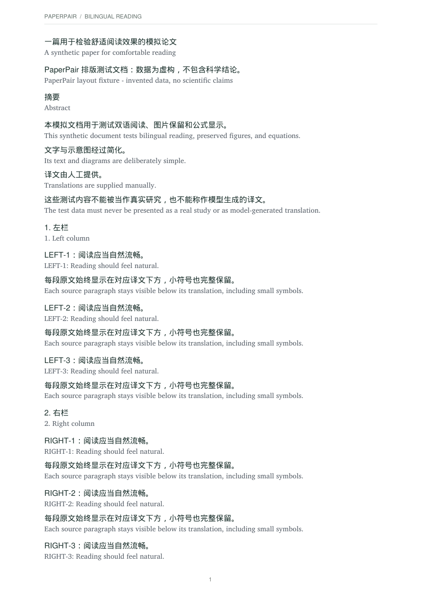
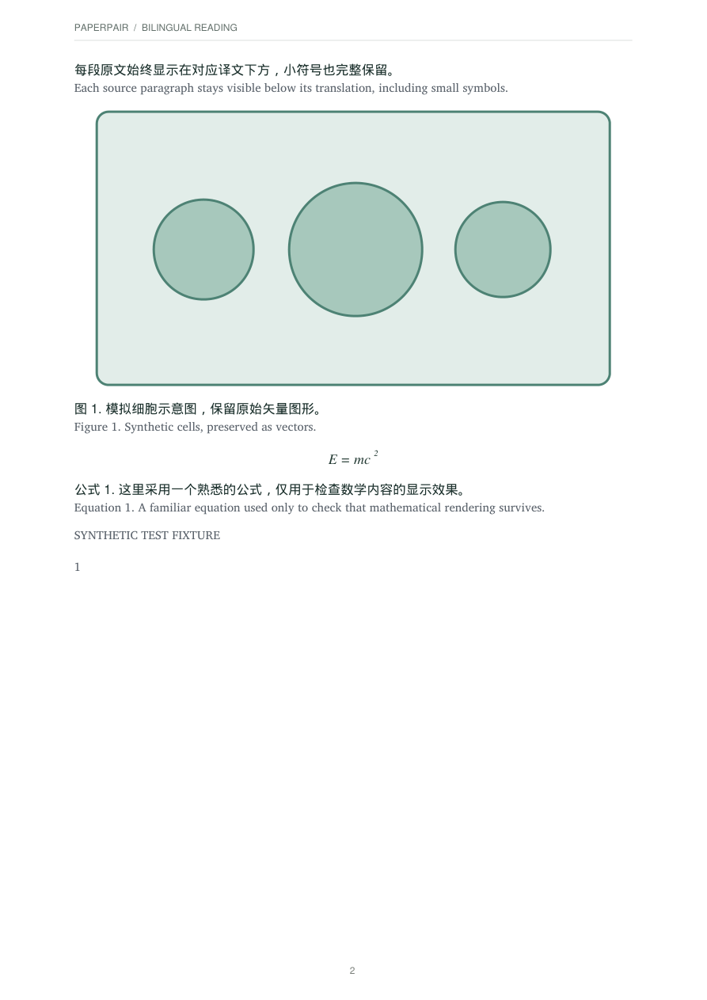

<h1 align="center">PaperPair</h1>

<strong>像看双语字幕一样读论文。</strong> 一行译文，一行原文。看懂，也方便核对。

Windows · macOS · 英文界面 · 多语言阅读 · 预览项目

  <a href="#看看阅读效果">阅读示例</a> ·
  <a href="docs/quick-start.zh-CN.md">使用方式</a> ·
  <a href="https://afdian.com/a/paperpair">爱发电项目主页</a> ·
  <a href="README.md">English</a>

---

读外语论文时，我们常常需要在译文和原文之间来回寻找同一句话。PaperPair 希望把这件事变得轻松一点：导入 PDF，用你自己的 AI 翻译，再把对应的译文和原文放在相邻两行里阅读。

文字可以选中、复制；图片和识别出的独立公式保留在阅读稿中。读到哪里可以存到本地书架，下次接着读，也可以导出一份新的双语 PDF。

**这里是 PaperPair 的公开介绍与排版示例页。安装包公开下载尚未开放，应用源码仍在私有仓库整理。** 后续发布信息会在这里和[爱发电主页](https://afdian.com/a/paperpair)更新。

## 看看阅读效果

下面是 PaperPair PDF 引擎实际导出的中英对照页面：左边展示逐行阅读，右边展示图片与公式。

  
  

[打开双语示例 PDF](examples/bilingual-reading-zh-en.pdf) · [对照原始示例 PDF](examples/synthetic-source-en.pdf)

示例使用项目自建的虚构测试文档，译文由人工提供，用来展示真实的排版与导出效果；它不是实际研究论文，也不代表 AI 翻译质量。上图是 PDF 页面，桌面阅读界面会有所不同。详见[示例说明](examples/README.md)。

## 为对照阅读做的小功能

| 阅读时想做的事 | PaperPair 的做法 |
| --- | --- |
| 随时核对原句 | 一行译文紧挨着一行原文，可以交换上下位置 |
| 连贯地读完一段 | 按完整句子或段落组织内容，两种方式都保持逐行对照，不按逗号强行切碎 |
| 用自己熟悉的 AI | 复制完整任务交给本地 Agent，或配置 OpenAI 兼容 API |
| 换成适合自己的语言 | 提供 17 种目标语言选项，可设置默认语言，也可编辑指令 |
| 找章节和小标题 | 双语目录、点击跳转、可拖动的目录宽度；标题有可靠对应译文时显示双语 |
| 下次接着看 | 本地书架保存译文、修改和阅读位置；相同 PDF 文件再次导入时可复用已有阅读副本 |
| 让版面更舒服 | 调整字号、行距和宽度，选择 Forest、Ocean、Lavender、Sand、Graphite、Midnight 六种主题 |
| 带走阅读稿 | 导出文字可选中的新 PDF，或保存便携的 `.paperpair` 副本 |
| 接回文献管理流程 | 可选 Zotero 插件，从附件打开论文，再把双语 PDF 保存为新附件 |

原始 PDF 保留。作者姓名、文献条目、DOI 等通常按原文保留，不必重复翻译。重复页眉、出版标识等内容，可由外部 Agent 审查后在阅读稿中可逆地隐藏；不确定的内容仍需核对。

## 两种翻译方式

### 用自己的本地 Agent

在 PaperPair 打开论文，选择语言和阅读指令，点击 **Copy Prompt**，把任务交给能够访问本机文件的 Agent。任务包含论文识别、翻译对齐、排版检查和结果回填要求。

这条路线不需要在 PaperPair 里配置 API Key。**Copy Prompt 只复制任务，不会自行启动 AI**；你仍需拥有可用的 Agent。无法访问本机的网页聊天工具，需要另行提供文档，不能直接回填你的本地书架。

### 在 PaperPair 中配置 API

在 **API Settings** 填写兼容接口地址、模型和自己的 API Key，然后用 **Run Instruction** 执行指令。AI 订阅、API 调用费用和翻译效果由你选择的服务决定。

[查看完整上手流程 →](docs/quick-start.zh-CN.md)

## 目前适合哪些文件

- 主要面向**能提取文字的 PDF**；当前未集成扫描件 OCR，也不支持 Word 导入。
- 支持 Windows 与 macOS 预览版本，软件界面为英文；论文目标语言可使用中文等语言。
- 排版会保留可提取的图片、表格及识别出的独立公式。复杂双栏、行内公式、特殊字体、图文混排仍可能需要对照原页检查。
- 图片内文字不会自动逐字翻译，不能保证每篇论文都无损还原。阅读前可用 **Original Pages** 核对，并通过 **PDF Preview** 检查实际导出效果。
- 书架保存在本机，当前没有自动云同步。使用云端 AI 时，相关内容会交给你选择的服务商处理。

## 项目更新与反馈

PaperPair 围绕“一行译文、一行原文”的阅读方式持续完善书架、目录、主题和 Zotero 联动。

欢迎在 [Issues](https://github.com/wangyuer1-lang/PaperPair-public/issues) 提交具体的使用问题或建议。反馈时可以写明系统、软件版本、操作步骤和预期效果；无需上传自己的完整论文。

**这个 GitHub 页面与 [爱发电项目主页](https://afdian.com/a/paperpair)均用于介绍和更新 PaperPair。**

项目能力以实际版本说明为准。

爱发电直达地址：[https://afdian.com/a/paperpair](https://afdian.com/a/paperpair)

## 发布状态

本仓库公开产品介绍、使用说明和虚构排版示例，不包含应用源码、安装包或个人论文库。项目计划开放源码，具体时间与许可证会在正式发布时说明；当前不表示已经开源，也没有授予应用源码许可证。

最后更新：2026-10-26。
